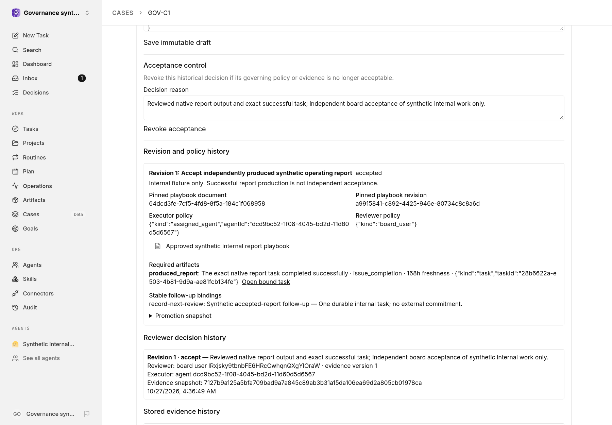

# Case milestones

A milestone belongs to a native Case and its primary task. It does not replace the task graph, successful task completion, handoff authority, routines, or accounting. Authorized board users append immutable contract drafts and explicitly promote them. Agents cannot author or promote policy, expand scope, or authorize external commitments.

## Contract and stored evidence

Every contract pins a case-linked playbook by `playbookBinding.documentId` and `documentRevisionId`. Promotion records its current stored revision, body hash, source trust, and producer provenance. A changed playbook requires a new board-approved contract; editing a document does not silently update the policy binding.

Each named deliverable has one exact typed reference, a supported `evidenceKind`, and an optional positive `maxAgeHours`:

- `issue_completion`: `{ kind: "task", taskId }` identifies a required primary or work-linked Case task. Only ordinary native `done` is successful; cancelled or reopened tasks do not qualify.
- `document_revision`: `{ kind: "document", documentId }` identifies a required Case document. Evidence supplies the current stored document revision UUID, not the document UUID. The current document pointer, revision number, stored body, SHA-256 body hash, source trust, and actual user/agent/run provenance must agree.
- `work_product`: `{ kind: "work_product", workProductId, issueId, productType, provider }` identifies the exact required **source** work product, not an interchangeable product of the same class. Evidence supplies the UUID of its native approved promotion **receipt**. The source must belong to the bound Case task, have a successful company-scoped producer run on a successfully completed linked task, and have gone through the native low-trust work-product promotion route. Its promotion trust must agree with the receipt's source identity, metadata and external ID. The source must not have changed since promotion. Evidence snapshots/hash bind both complete stored source and receipt versions, metadata/content identity, URLs, timestamps, and producer-run provenance. Changes hold acceptance and delivery rather than silently verifying a replacement.

Native promotion and milestone acceptance are distinct decisions. Writable `approved`/`reviewState` fields alone are not an acceptance receipt. Quarantined, missing, foreign-company, wrong-resource, stale, or unsupported evidence is rejected. This implementation supports work-product-source promotion receipts only, not receipts promoting comments, documents, or issues. It verifies native stored artifact/approval provenance; it does **not** contact providers, prove a remote URL's contents, merge a pull request, validate an external measurement, or make an external commitment. Arbitrary external evidence claims are unsupported.

Required task sources are retained using native Case privacy provenance, so historical criteria/evidence do not become readable merely because their task link later changes. Case and retained source authorization also applies to milestone reads. Authorization is not granted by UUID possession.

## Independent review and current acceptance

`executorPolicy` permits any authorized internal agent or pins an exact assigned agent. `reviewerPolicy` is either `board_user` or `independent_internal_agent` with an exact `agentId`. The reviewer must have current native Case/resource/source authority and differ from the actual executor and all actual artifact producers, for both user and agent principals. Attaching someone else's evidence does not change its producer. An independent board user can review another user's work; board access does not permit self-acceptance. Internal agent acceptance is internal work verification, not human policy promotion or external approval.

Acceptance locks current stored artifacts/tasks, rereads their versions and assignment, rechecks canonical Case/run/Stop authority after blocking locks, and checks the reviewed evidence snapshot. Current authenticated key identity comes from the canonical request actor; its actual key row, revocation, scope, and responsible user are fenced in the transaction. Retained privacy/resource grants, memberships, and policy-bearing resources are locked with the authoritative write. Decisions retain nonsecret canonical reviewer source/principal/key/scope/responsible-user context and executor principal context for subsequent current-authority evaluation. No token, key hash, session token, or recovered credential is stored in milestone events. Native run authority is checked for the current mutation; historical review is not reauthenticated by inventing a session or credential from a principal UUID.

Cloud board privilege follows native source semantics: only the current attested `cloud_tenant` actor supplies computed instance-admin privilege; database instance-admin rows never elevate that source. Historical approval does not save or replay that exceptional privilege. It is revalidated using current membership/resource/source authority, or a fresh matching canonical cloud actor supplied by the current request. If exceptional privilege cannot be freshly established and ordinary current access is insufficient, acceptance is held as stale; a current explicit resource grant can satisfy ordinary access without exceptional elevation. Session, board-key and local-implicit authority retain their native identity and current credential/membership checks.

The readiness service returns `accepted: boolean` as the acceptance gate:

- `eligible_for_review` / `eligible=true`: current evidence may be independently reviewed; this is **not** acceptance.
- `accepted_current` / `accepted=true`: the active accepted revision, current requirements, evidence snapshot, and reviewer/executor authority remain valid.
- `accepted_stale` / `accepted=false`: a historical acceptance exists, but a current requirement fails, including a reopened primary task, changed source/playbook, or lost reviewer authority. The historical decision remains visible.
- `blocked`: there is no currently reviewable accepted contract/evidence state; `reason` explains the hold.

`executionAllowed` is false without a current approved active/accepted contract, including draft-only and revoked-without-replacement milestones. Under an approved contract it evaluates a proposed executor against pinned policy/current principal authority independently of post-work completion and evidence, so a producer can start authorized work before producing deliverables. Consumers requiring acceptance must check `accepted`, never `eligible` alone; dispatch additionally checks `executionAllowed` for its supplied executor. Actor-specific `canReview` and `canAccept` include the same effective executor fallback and producer independence as decisions. Read-only capability evaluation checks current run cancellation, handoff, native running state, task ownership and work mode without acquiring lasting authority or retaining new Case sources. A historical review run merely finishing or stopping does not itself invalidate otherwise current approval provenance.

## Decisions and durable internal follow-ups

Accept, reject, revoke, and supersede decisions retain immutable history. Acceptance, revision transition, business event, configured native internal task creation, durable receipts, and event acknowledgement commit in one transaction. A failure rolls all of them back. No remote effect is invoked.

Acceptance and follow-up replay acquire the native company numbering row with `FOR NO KEY UPDATE`, then the existing `issue-privacy-tree:<companyId>` advisory, before milestone/Case/source/task/artifact locks. Native task/run/Case helper order remains unchanged inside these outer fences. Follow-ups do not supply graph-mutating `blockedByIssueIds`; a caller that does must take the existing company graph advisory between company and privacy. This prevents native privacy mutation from holding privacy while waiting for a source task already held by milestone creation.

Follow-up identity is exactly **companyId + milestoneId + acceptedRevisionId + stable actionKey**. The same revision/event replay reuses its task receipts. A different accepted contract revision has a different logical follow-up even when its action key is unchanged. Mutable playbook/definition edits are not identity inputs. The receipt constraint, lookup, native origin and issue idempotency key use the same identity. Replay serializes with promotion/decisions and reevaluates current acceptance and authority before any new delivery/acknowledgement. Revoked, superseded, stale, or unauthorized acceptance cannot create new work. Already-created tasks and receipts remain history; there is no automatic undo of effects or replay of external actions. Initial delivery is synchronous and transactional, so no second scheduler/controller is required.

Before creating or newly acknowledging configured follow-up work, the current canonical actor must pass native `tasks:assign` authorization for the proposed child, parent task and inherited project. A pinned milestone verifier does not gain extra key scope: an unchanged `skill_test` key may read its task but cannot create a follow-up. Such denial rolls back the decision, revision transition, event, task and receipt together. An already acknowledged replay with complete receipts returns existing effects without creating new work.

## Panel and API

The Case detail panel loads the stored current/draft contract into its JSON editor, appends revisions, exposes board promotion, and accepts exact stored evidence inputs. It displays full references, policies, freshness, pinned playbook, evidence hashes/provenance, reviewer/executor-correlated decisions and native task receipts. Denials/conflicts are displayed without impersonating a verifier. Reload after a conflict before reviewing or resubmitting. Document previews and source task links remain subject to native resource authorization.

- `GET /api/cases/:caseId/milestones`: read-only history, readiness, and actor capabilities; never dispatches work.
- `POST /api/cases/:caseId/milestones`: create/reuse the native Case association.
- `POST /api/milestones/:milestoneId/revisions`: board-authored immutable contract draft.
- `POST /api/milestones/:milestoneId/revisions/:revisionId/promote`: board promotion with `expectedActiveRevisionId` (`null` initially); intervening promotion returns 409.
- `POST /api/milestones/:milestoneId/evidence`: append `{ deliverableKey, evidenceKind, artifactId, expectedRevision, expectedEvidenceVersion }`; stale contract/evidence references return 409, and wrong stored resources return 422.
- `POST /api/milestones/:milestoneId/revisions/:revisionId/decisions`: `{ outcome, reason, expectedRevision, expectedEvidenceVersion, expectedEvidenceSnapshotHash }`. Echo both the version and SHA-256 snapshot observed by the reviewer; intervening evidence/artifact/assignment changes return 409, not acceptance of a newly observed artifact.
- `POST /api/milestones/:milestoneId/followups`: `{ eventId }`, an authorized idempotent replay surface.

The reusable service is `governanceMilestoneService(db).getMilestoneReadiness(companyId: string, milestoneId: string, executor?: MilestoneExecutor, currentActor?: AuthorizationActor): Promise<MilestoneReadiness>`, with `MilestoneExecutor = { agentId?: string; taskId?: string }`, from `@paperclipai/shared/governance-milestones`. Existing three-argument consumers are unchanged. The optional fourth argument is server-only canonical current-request authority, never client payload or saved credentials; the owned route supplies it for fresh matching cloud attestation. Background consumers without such attestation fail closed on exceptional-only historical access.

## Interface example

Synthetic demonstration data.

