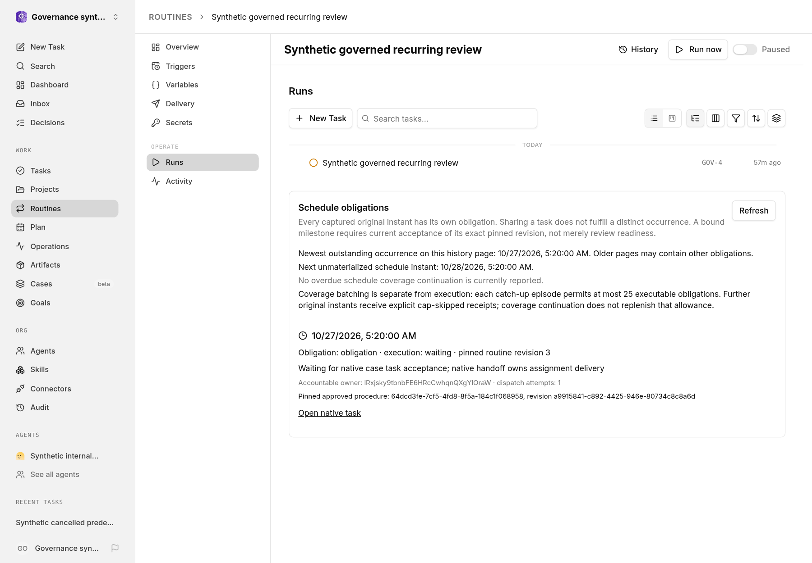

# Routine schedule occurrences

Routine schedules continue to use the native scheduler. Capturing due work locks the native routine and trigger, inserts original scheduled instants into `routine_occurrences`, and advances the trigger in one database transaction. Identity is company + routine + trigger + original scheduled instant, independent of later template edits. The captured routine revision and approved workflow document/revision, milestone/revision, case, and native case handoff version are durable business-definition bindings. Replay uses that revision, while current routine/trigger eligibility, project pause, worktree, activity gate, active accountable owner, assignment permissions, and private-resource authority are checked again.

## Catch-up and coverage

A tick materializes at most 25 original instants per trigger. This coverage batch is distinct from the execution allowance: `enqueue_missed_with_cap` permits at most 25 executable obligations over one persisted catch-up episode, not 25 per continuation. The trigger retains the episode cutoff, pinned revision, consumed execution allowance, and latest-only policy until all instants through that cutoff are accounted for. Excess instants receive individual `skipped` occurrences and native skipped run receipts with an execution-cap reason. `skip_missed` and the native sub-hourly policy skip older instants and retain only the latest eligible instant. Current pause, activity, concurrency, and other suppression policies remain in force. A batch never advances past an uncovered instant. Restarts, competing controllers, and definition edits do not reset an episode's allowance or replace its pinned schedule; edited definitions apply after its coverage completes. The Runs panel exposes incomplete coverage, continuation, episode cutoff, and consumed allowance. Reads do not dispatch work.

## Dispatch, receipts, and uncertainty

Each dispatch attempt has its own fence. Native run/task creation and occurrence linkage commit together under native locks. Post-commit assignment wake uses the existing native wake idempotency receipt; a receipt is not invented merely because a routine run exists. A committed task without delivery remains pending and can be safely resumed. Native case execution uses an idempotent case handoff, and the existing case handoff delivery worker alone owns its assignment wake; the routine does not send a second wake. An existing native case primary task is reused rather than creating a competing primary task; its handoff references an occurrence-specific native task document containing the full pinned instructions. A terminal primary task is not silently reopened.

While that first assignment wake is pending, matching `coalesce_if_active` dispatches reuse its committed native creator run/task under the routine lock. Selection requires the exact dispatch fingerprint and the creator's still-open `issue_created` linkage without an assignment receipt; an unrelated open idle task is not active work. `skip_if_active` records its own skipped receipt, different fingerprints remain separate executions, and `always_enqueue` does not coalesce. Shared execution still leaves separate schedule obligations unsatisfied until their own acceptance rules apply.

If an attempt expires without an authoritative receipt, or wake initiation may have escaped without a durable receipt, execution becomes `unknown`. Lease timeout is not evidence of no execution. Automatic ticks do not blindly retry unknown effects. When a native run/task exists but its wake receipt is still absent, reconciliation preserves `unknown` and persists the check time, moving its next receipt check 60 seconds into the future instead of continuously returning an overdue deadline. Durable native receipts can still reconcile late links and completion. Every acknowledgement compares the current state and attempt fence, so a stale attempt cannot overwrite a replacement, waiver, or newer uncertainty decision.

The existing `routine-schedules` delivery coordinator owns this work. Capture signals it transactionally; its registered `tickRoutines` callback calls `tickScheduledTriggers`, which also resumes persisted pending/expired work and reconciles receipt/evidence states even when no trigger is currently due. Native startup registration runs an initial pass, and the existing heartbeat scheduler also wakes that queue. Runtime registration must union `routineOccurrenceDeadlineQuery(now)` with the native trigger deadline query, clamping overdue trigger continuations to the current cutoff rather than excluding them. The occurrence query restores pending/retry and lease-expiry deadlines, and schedules receipt/pinned-evidence reconciliation after 60 seconds independently of the next cron tick. This includes a task completed before later milestone acceptance. An unknown attempt without any native receipt is not an automatic dispatch deadline. Use the existing coordinator callback/deadline mechanism, not another scheduler or timer.

Before native task/run/document writes, creator admission takes company then privacy authority and rechecks current Case visibility, actor write trust, and native Case execution trust. The selected immutable workflow revision and its document's current source trust are reread under a shared row lock before copying effective instructions; a quarantine committed after preflight therefore denies admission. Actual native handoff/source release and wake delivery remain postcommit.

## Obligation and execution states

`disposition` is the schedule obligation decision: `obligation`, `satisfied`, `skipped`, `waived`, or `suppressed`. `executionState` independently reports `pending`, `dispatching`, `waiting`, `failed`, `cancelled`, `unknown`, `skipped`, or `satisfied`. A queued/failed/cancelled/suppressed wake, cancelled or blocked task, or terminal routine run is not accepted completion. A native task's accepted `done` status can fulfill its own occurrence; coalescing into a shared task does not automatically fulfill distinct schedule obligations.

A milestone-bound producer is admitted by execution authority before post-work evidence exists. Fulfillment requires the milestone getter's current, still-valid `accepted` decision for the exact pinned milestone revision, not merely review eligibility or acceptance of a replacement revision. Reusing a case primary task additionally requires this occurrence's own current, unsuperseded native case handoff and independently accepted pinned milestone evidence. A newer handoff cannot let shared task completion satisfy older distinct obligations. Stored accepted task status versions support reconciliation when acceptance becomes invalid.

## Runs panel and accountable exceptions

The real routine Runs panel shows persisted current/next/history, original times, pinned revisions and approval bindings, execution separately from fulfillment, native task links, catch-up continuation, and paginated decision history. Task links use native `/issues/:id` routes. Routine activity includes `routine_occurrence` audit events. Live routine detail, native run history, immutable revision history, and occurrence history use canonical actor/source authority. Current and historical pinned parent, project, Case, and approved-workflow sources are checked before revision content is returned; denied history rows are filtered before visible limits. Company portability exports pass the actual route actor through routine detail reads rather than using an actorless export path. Unreadable parent/source bindings deny the routine projection; private linked task histories, including their payloads and failures, are filtered before filling the requested run limit. UUID possession is not permission.

Authorized board users can skip or waive with a reason and an active accountable company-member owner. Dispatching or waiting execution cannot be disposed this way; unknown execution can only be waived after review. Agent actors cannot change disposition. The domain change and audit event commit together before activity publication. Human policy/external approvals remain distinct from an authorized independent internal-agent milestone acceptance.

The API returns `RoutineOccurrencePage` from `GET /routines/:id/occurrences?limit=50&cursor=...`: `items` (including `decisionHistory`), `nextCursor`, `canDecide`, and `catchup` (`batchLimit`, `hasMoreDue`, `nextScheduledAt`, `executionLimit`, and `episodes` with `triggerId`, `cutoff`, `revisionId`, `executionsConsumed`, `latestOnly`). `POST /routines/:id/occurrences/:occurrenceId/disposition` accepts `{ "disposition": "skipped" | "waived", "reason": "...", "ownerUserId": "..." }`. Route authorization passes the real native actor/run/key/source context; pagination/options are validated. There is no separate occurrence-item GET route.

These records are a durable accounting and reconciliation layer around native routines, tasks, case handoffs, and wake delivery, not a second scheduler or direct provider dispatcher. The dedicated PostgreSQL behavior suite covers transaction rollback, competing controllers, crash/replay and stale attempts, explicit catch-up/suppression, native receipts, case delivery deduplication, current eligibility, accepted pinned milestone evidence, private resources, native source restrictions, and accountable route decisions. Test execution belongs to integration; no runtime result is implied by this guide.

## Interface example

Synthetic demonstration data.

