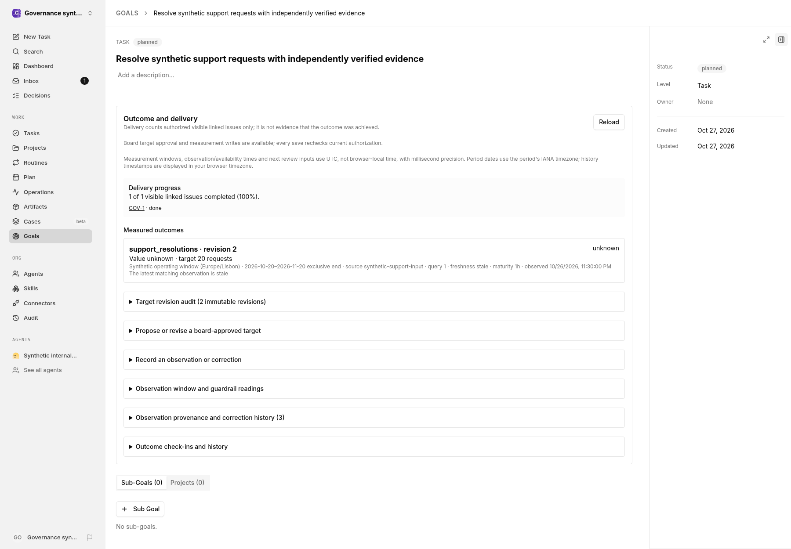

# Goal outcomes

Goal outcomes are a typed measurement ledger attached to native goals. Task completion is shown separately and never implies that a measured outcome was achieved. The initial connector is typed API ingestion only: the application does not connect to external sources, execute a source query, or activate live data access.

## Authority and scope

- Only a board user can create an immutable target revision. `expectedRevision` is a compare-and-swap value; the same metric key advances only from the revision explicitly loaded by the proposer. Agents cannot approve or ratify target changes.
- Observation writes require current company/run authorization and the target's assigned metric owner; a narrower native key or execution scope cannot be overridden by metric ownership. Scoped or low-trust actors denied by native authorization cannot access company-wide outcome data.
- A corrective issue is accepted only when the submitter currently has native `issue:read` access. Private and nonexistent references receive the same opaque denial; GET rechecks current issue authorization and redacts a reference after access is revoked.
- Goal visibility and application authorization remain the source of access decisions. These permission checks are not an OS sandbox; the API stores source/query identifiers and provenance but does not establish provider access or execute external queries.
- The outcomes GET derives control capabilities from the current server-authenticated actor and company memberships: `canApproveTargets`, `canCheckin`, and explicit `observationTargetIds`. Company viewers retain readable health, delivery and history, but mutation forms are disabled. An agent never receives target-policy approval controls and can record observations only for its explicitly assigned targets. Acting on behalf of a read-only company member does not grant write controls. Capabilities are presentation metadata, not a token or authorization bypass: every mutation still checks native current company/run/key/source restrictions. Account/company/goal changes reset the local editor state.

## HTTP API

The application mounts these under `/api`:

- `GET /goals/:id/outcomes` returns periods, target revisions, the complete observation/correction ledger and check-ins, plus a computed current-outcome projection and server-derived `capabilities` for the current actor/company. Check-in corrective references are reauthorized on every read and hidden when no longer visible. Outcome health is separate from issue delivery progress.
- `POST /goals/:id/outcomes/targets` creates a board-approved immutable revision. It requires `expectedRevision` (`0` for the first), period label/timezone/UTC interval/lifecycle, metric key and kind, unit, direction, aggregation, population, source/query version, freshness and maturity limits, baseline/target or range, owner, guardrails, and trajectory. Reusing a period identity with a different timezone or lifecycle conflicts; historical period definitions cannot be updated.
- `POST /goals/:id/outcomes/observations` appends a typed observation with target ID, source revision and stable source key, value, unit/population, observation window/time, availability time, and guardrail values. The native actor, source, run and key provenance are persisted with the observation and native activity audit in one transaction. Identical source-key replays return the original row; changed content conflicts.
- `POST /goals/:id/outcomes/observations/corrections` appends a replacement with its superseded observation and reason. Identical correction retries reuse the original row; a changed correction identity or payload conflicts. History is preserved and the superseded row is excluded from current health.
- `POST /goals/:id/outcomes/checkins` appends health, evidence, forecast value, uncertainty, optional currently authorized corrective issue and next review time. The reference is reauthorized at submission and redacted from later reads after access is revoked.

Validation rejects non-finite values, invalid intervals, unsupported enum values, invalid IANA timezones, missing units/populations/source metadata, invalid target bounds, malformed correction/check-in data, and availability before observation time. API times are UTC instants. The observation, availability, window and next-review `datetime-local` controls deliberately present **UTC wall-clock values**, explicitly labelled UTC, with millisecond precision; submission appends `Z` rather than parsing browser-local time. Unedited defaults therefore retain the same instant in any browser timezone. History timestamps use the browser timezone. Business-calendar period dates use the period's IANA timezone, and unchanged loaded boundaries retain their original full instants rather than being rounded to midnight. Period end is exclusive.

## Measurement semantics

- `increase` targets move from an optional baseline toward or beyond the target. Falling below baseline is a guardrail failure.
- `decrease` targets move from an optional baseline toward or below the target. Rising above baseline is a guardrail failure.
- `range` targets are achieved only inside inclusive lower/upper bounds.
- `latest` selects the matching observation with the greatest `observedAt`, never the most recently ingested row.
- `sum` aggregates only non-overlapping observation windows. Active sum-target periods for the same metric's effective contract cannot overlap; unrelated metrics and superseded revisions do not create a conflict. Overlapping samples are rejected on write and unknown if encountered during evaluation.
- Only observations matching the current active target period, unit, population, approved source, and window are eligible. Missing, stale, out-of-period, incompatible, or overlapping data is `unknown`, not zero and not achieved.
- Future observation, availability, or ingestion times cannot establish current achievement. Each target stores a maturity interval (default 24 hours); a window/cohort remains `unknown` until its window end plus that interval, and until the sample is actually available.
- Every required guardrail must have a recorded value that passes its threshold. Missing or failed guardrail values hold achievement.
- Observations bind one immutable target revision, approved source, population/unit and period window. Corrections append a row with an explicit parent/reason; they do not rewrite history, and a target can have only one correction branch.

## Delivery view and privacy

The Goal detail displays outcome health beside a separate delivery panel. Delivery uses the existing authorized, cursor-paginated issue listing and counts only visible issues directly linked to the goal; visible rows are native issue links. It does not issue a private aggregate-count query, so hidden issues cannot affect the displayed count.

## Revision and provenance history

Target and period definitions are immutable; target history includes approval, time, period lifecycle/calendar boundaries, source/query version, freshness/maturity policy, owner, guardrails, and trajectory. Observation history across current and historical target revisions includes source/key, measurement window, observed/available/ingested times, value/unit/population, submitting actor/source/key/run, guardrail readings, and correction parent/reason. Native activity audit is written atomically with authoritative mutations. Check-ins retain evidence, forecast uncertainty, author and next review; an authorized corrective-work reference is a navigable native issue link and is redacted after access revocation. The UI binds compare-and-swap to the proposal's loaded revision and preserves unchanged business-calendar instants on resubmission. Target change is a governance decision; there is no agent self-approval or mutable acceptance-criteria path.

## Persistence and native deletion

Company agreement is enforced in PostgreSQL, not just by API preflight: periods reference native `(goals.company_id, goals.id)`, target owners reference `(agents.company_id, agents.id)`, and check-in corrective issues reference `(issues.company_id, issues.id)`. The target/period, observation/target, correction/observation and check-in/target chains also have compound same-company/goal foreign keys. A nullable owner or corrective issue may be omitted when the historical row is created; a non-null reference must belong to that company.

Owner-agent and corrective-issue references use `ON DELETE NO ACTION`, not `SET NULL`: deleting a referenced native row is rejected while its immutable outcome history exists. Deletion cannot silently rewrite an approved owner or check-in, or trip an attempted nulling update against the history triggers. Goal periods and direct goal/company references retain native cascading goal/company cleanup; the internal outcome-chain foreign keys still enforce referential integrity at statement completion. All four outcome history tables reject updates via `reject_goal_outcome_update()` and their immutable triggers. Visibility revocation redacts corrective references in API responses without altering stored history.

## Interface example

Synthetic demonstration data.

