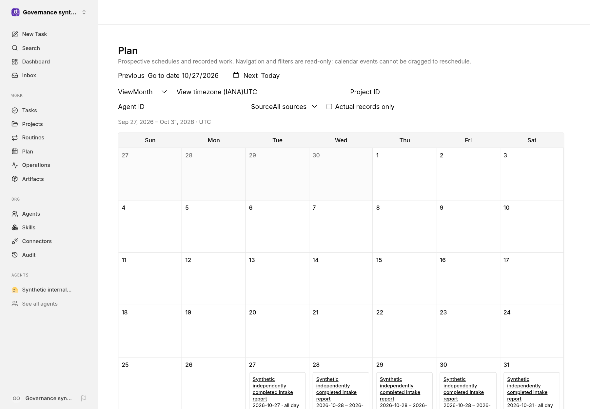

# Governance planning

The **Plan** page is a bounded, read-only projection of issue planning fields, native task execution timestamps, enabled routine schedules, persisted routine occurrences, and recorded routine runs. It is separate from Work Timeline history. Month, week, day, and agenda views navigate in the selected IANA timezone. Project, agent, source, and actual-record filters apply across the matching sources. Calendar events are never draggable; GET requests do not dispatch work, reschedule routines, or write provider state.

Date-only `from`/`to` ranges cover the local calendar interval `[from, to)` in the requested timezone. Offset-qualified instant bounds are also accepted. Ranges are limited to 62 calendar days; calendar results default to 200 events and cap at 500. Each source is limited to 5,000 authorized candidates and generation to 5,000 events. Routine forecasts share a per-request budget of 100,000 inspected candidate minutes across all native cron searches, including the first overdue calculation; searches never inspect a minute at or beyond the exclusive projection end. Each trigger also caps generated recurrence at 2,000 ticks. Budget exhaustion sets `incomplete` only when candidate minutes remain uninspected. A fully searched no-match interval is complete even when its final inspected minute uses the last budget unit; a subsequent empty interval also remains complete at zero budget. The unplanned-task selector defaults to 100 rows and caps at 200, retaining at most the requested authorized limit plus one. Responses distinguish authorized result truncation from incomplete computation. Source and task queries page in batches of at most 200 candidates, applying full native read decisions before retaining rows against an authorized bound. Denied rows do not consume those bounds or change completeness flags. The number of batches can grow with denied candidates; there is no fixed raw-row cutoff that hides authorized rows behind them. Narrow the date range or filters when an authorized cap warning appears.

Each `issue_planning` row has an optimistic `revision` and keeps earliest start, planned start/finish, hard deadline, forecast start/finish, and recorded actual start/finish independently. The `dateMode` explicitly distinguishes `timed` values (timezone-qualified instants) from `all_day` values (validated calendar dates); all-day dates are not UTC instants. An IANA timezone is persisted for interpretation and editing. Timed records open in the selected calendar timezone; all-day records retain their stored timezone by default. The timed editor rejects daylight-saving gaps and chooses the earlier instant only for newly authored ambiguous fall-back input. Unchanged loaded instants preserve their exact stored value, including seconds, fractional precision, offset, and a later fall-back fold. Changing the editor timezone re-presents saved and resolved draft instants, rather than rescheduling them. The loaded proposal keeps its original `expectedRevision`; background data does not advance that revision. The editor never relies on browser-local date conversion. Changing date meaning requires clearing all editable date inputs; stored actual dates remain read-only in the page. The project `targetDate` is not changed or reinterpreted.

Authorized non-viewer board users can update planning fields through `PUT /api/issues/:id/planning` with `expectedRevision`, `timezone`, and explicit `dateMode`. A first write uses revision `0`; later writes must supply the loaded revision. Conflicting updates return HTTP 409. Omitted date fields retain stored values, while explicit `null` clears a field. The complete resulting row, including retained fields, is validated under the locked CAS transaction: changing mode requires clearing or replacing incompatible old dates; changing one interval endpoint cannot invert a retained interval. Each successful authoritative update and its activity audit record commit transactionally. Invalid dates, inverted planned/forecast/actual intervals, invalid IANA zones, or date-mode mismatches return HTTP 400 without changing the row/revision/audit. The authorized unplanned-task selector provides a route to create the first planning row without requiring an existing calendar event. The calendar response's server-derived `canEditPlanning` capability hides editing controls from viewers and agents while keeping their authorized calendar access.

All calendar, selector, selected-task and editor state belongs to one resolved account/company scope. Changing account or company remounts that entire planning subtree, discarding old selections, loaded revisions and results; late old-scope reads cannot populate the new scope. An unresolved account hides planning rather than reusing another account's state. Returning to a prior scope starts a fresh read and requires selecting the task again. Explicit saves already submitted are not retroactively cancelled, but their late responses cannot reopen or update an editor in another scope.

Collection reads require native `company_scope:read` plus per-resource issue/project read decisions. Native SQL privacy predicates prune candidates, but are not treated as complete authorization: each bounded page also passes through native `decideReads`, including resource trust policy, actor/source, run and user intersections, before source/selector caps or completeness are computed. This preserves MCP OAuth's native non-elevation rule even for an instance administrator. An allowed `issue:read` decision suffices for that issue's planning fields, including implicit principals and active explicit grants inside unreadable private projects; it does not grant project-wide access. Project resources and routine-owned project fields are protected independently. If a readable routine inherits an unreadable parent project, its project scheduling state is reported unavailable rather than exposing whether that project is paused. Direct issue planning reads use native accessible-resource and issue authorization checks; inaccessible issue IDs are masked as not found. Company collections do not allow task-bridge/skill-test scopes or bypass current agent/source/responsible-user/external-authorizer restrictions.

Issue events label earliest, planned, deadline, forecast, and recorded actual dates separately. Native task start/completion/cancellation timestamps are shown as actual history, not plans. Routine forecasts reuse the same timezone-aware cron tick calculator as the native scheduler; they are projections, not promises of execution. Paused routines/projects, incomplete setup, invalid definitions, and bounded or unsupported recurrence states produce warnings instead of success claims. Persisted routine occurrences retain their stored disposition and execution state; an occurrence record alone is not evidence of a successful run. Recorded run statuses remain verbatim. Task links use `/issues/:id`; inaccessible linked tasks fall back to their routine detail page.

Only native recurring `schedule` triggers have predictable future ticks in this refreshed baseline. API/webhook triggers are not forecasted, and there is no one-time-schedule contract in this baseline to project. No alternate scheduling controller is introduced. Native cron semantics remain authoritative, including timezone DST gaps/folds and day-of-month **AND** day-of-week matching. A saved tick from an invalid current cron definition is not displayed as a valid forecast.

The admission interface is `getIssuePlanningGate(db, companyId, issueId, now, executor?)`. It is a read-only earliest-start predicate: an executor mismatch cannot hide an existing planning restriction and returns a non-ready `unknown` decision. No calendar endpoint adds a timer or changes native scheduler, provider, review, or authorization state.

## API

- `GET /api/companies/:companyId/governance-calendar`: required `from` and `to`; optional `timezone` (default `UTC`), integer `limit`, UUID `projectId`/`assigneeAgentId`, `source=all|issue|routine|run`, and `actualOnly=true|false`. Returns events, normalized instant/date bounds, timezone, `truncated`, `incomplete`, warnings, and the current request's `canEditPlanning`. Actual-only means persisted records/native timestamps, not successful execution.
- `GET /api/companies/:companyId/governance-calendar/tasks`: optional `query` (at most 100 characters), integer `limit`, UUID project/agent filters. Returns authorized active tasks without a planning row plus `truncated` and `incomplete`.
- `GET /api/issues/:id/planning`: authorized persisted record (including `revision`) or `null` when no plan exists. Inaccessible/missing issue IDs return 404.
- `PUT /api/issues/:id/planning`: supported board-only explicit planning edit. Distinct date fields are `earliestStart`, `plannedStart`, `plannedFinish`, `hardDeadline`, `forecastStart`, `forecastFinish`, `actualStart`, and `actualFinish`. All-day interval finishes are inclusive calendar dates; timed interval finishes are exclusive instants for calendar overlap. The UI preserves, but does not edit, recorded actual dates.

All reads and navigation remain non-mutating: no dispatch, provider writes, drag-to-reschedule, or implicit first-plan creation.

## Interface example

Synthetic demonstration data.

